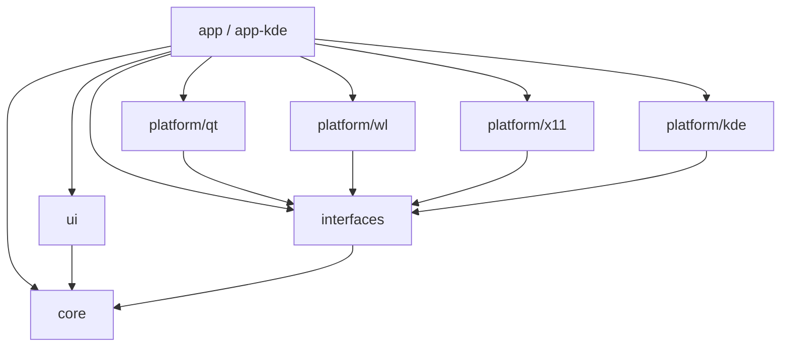
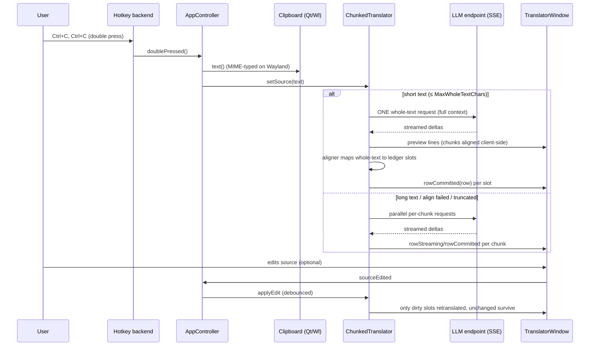

# Traduku — architecture

A clipboard translator: select text, press the trigger key twice, and the
translation streams into a DeepL-style window. Any OpenAI-compatible
endpoint works (Ollama, llama.cpp, vLLM, LM Studio, OpenAI, OpenRouter, …).

This document is the orientation guide for future developers. The golden
rule of this codebase is at the bottom; read it first if you contribute.

## Layout

```
src/
  core/        pure business logic — Qt only. No KF6, no X11, no D-Bus.
  interfaces/  abstract contracts (clipboard, hotkey, notifier, autostart)
  platform/    implementations behind the interfaces
    qt/        QtClipboard (X11/Wayland-transparent), XdgAutostart
    wl/        WlClipboard (portal + raw devices), ClipboardFactory
    x11/       X11HotkeyBackend (libXI raw events)
    kde/       KdeTray, KdeNotifier, KdeGlobalShortcut (KF6 shells)
  ui/          Qt Widgets only: TranslatorWindow, SettingsDialog
  app/         AppController (wiring), SelfTest
    kde/       main() — the KDE composition root
tests/
  unit/        no sockets, no event loops where avoidable
  integration/ real QTcpServer mocks on 127.0.0.1, QApplication wiring
tools/         mock-openai.py — streaming dev endpoint
packaging/     arch/ (PKGBUILD + mkrelease.sh), debian/ (debhelper 13)
```

Layering is strict and one-directional:



`core` must stay buildable and testable with Qt alone. If you find
yourself writing `#include <KNotifications>` inside `core`, stop: that is
the job of `platform/kde` via an interface.

## Data flow



## The core pieces

### DoublePressDetector (core)
Pure, clock-injected state machine: same key twice within the interval
fires; the third and later presses in a burst are ignored. Every key
transition releases the arm — the two presses must be *separate* taps.
`ShortcutMonitor` (core) adapts a single-press global hotkey (KGlobalAccel,
GNOME portals) into the same `doublePressed()` signal, so shells only ever
wire one event.

### Settings (core)
Plain INI (`[General]`, `Key=Value`), *not* KConfig — the user edits it in
a text editor; KConfig's write-only format disqualifies it. `QSettings` is
kept behind a `unique_ptr` so reload() replaces the instance (the IniFormat
writer caches `[General]` per file). Every getter takes an explicit
fallback (Qt 5.15's no-arg value() is deprecated). A `QFileSystemWatcher`
hot-reloads external edits. The config path is
`$XDG_CONFIG_HOME/traduku/config.ini`; `configFileExists()` snapshots the
disk *before* any `QSettings` instance touches the file (Qt creates empty
files lazily on sync).

### SseParser (core)
Incremental `data:`-line parser. Handles: partial lines, UTF-8 sequences
split across socket chunks (via `QStringConverter` stateful decoder),
`\uXXXX` pairs split across events, `[DONE]`, CRLF, usage chunks. Also
captures `finish_reason` (see truncation below).

### LlmStreamClient (core)
POSTs `stream: true` to `<baseUrl>/chat/completions`, pumps the reply
through `SseParser`, emits `delta`/`completed`/`failed`, exposes `cancel()`
(user-intent cancel suppresses `failed()`), and `truncated()` when the
server reports `finish_reason=length` mid-stream.

### TranslationEngine (core)
Prompt assembly (system prompt with the source-text delimiter guard,
number-format preservation, target-language sentence), one-request
serialization, language-code display names. Pure; mock-testable.

### Chunker → TranslationLedger → ChunkedTranslator (core)
The heart of the live-editing and document-translation design.

- `splitChunks(text, maxChars)` is lossless: paragraphs → sentences →
  words → hard cuts, and `join(split(t)) == t` is a *tested invariant*.
- `TranslationLedger` is the state: slots with separators and per-slot
  translations. On a source edit it diffs old/new text (LCS) and dirty
  only the slots whose source changed — untouched slots keep their
  translations, the paragraph you edited is the only one retranslated.
  The LCS walk reconstructs exact operations from the DP table
  (a greedy walk silently invents deletions — it is tested).
- `ChunkedTranslator` runs a pool of at most `MaxParallel` engines over
  the dirty slots, emits per-row streaming signals, and implements
  **Document mode**: for texts ≤ `MaxWholeTextChars` it sends ONE
  whole-text request (full literary context, faster and better than
  fragmented chunks), shows per-chunk lines live as a client-side prefix
  alignment, then re-aligns the finished text with the aligner and
  commits slot by slot.

### Aligner (core)
Maps a whole-text translation back onto source chunks. DP alignment
(Needleman-Wunsch) over word counts: `match` costs `|ln(source/target
word-ratio)| / 2` (free at 1:1 length, rising as the model compresses/
expands), drops cost `GapSource`, insertions cost `GapTarget` — the
asymmetry lets the algorithm *choose* to drop/insert empty slots. A tail
anchor (the last slot can never be dropped) pins the alignment from
drifting; empty slots get an ε-gradient so ties resolve deterministically.
Quality gate: mean cost ≤ 0.5, sanity gate: >50% empty slots ⇒ reject.
A rejected alignment falls back to per-chunk translation — a bad mapping
never reaches the user.

### Truncation resume
`finish_reason=length` on a document request → the aligned prefix is
committed, the tail chunks continue through the normal chunk pool
(starting exactly where the model stopped). Chunk requests keep their
trailing separator (the prompt asks for a verbatim tail).

### Clipboard (platform/qt + wl)
X11: plain `QClipboard`. Wayland: `WlClipboard` prefers the
`org.kde.KClipboard` D-Bus (KDE-specific, with MIME type) and falls back
to wlr-clipboard / virtual-keyboard *raw* `wl_data_device` handling —
type negotiation matters: on `text/html` the KDE daemon serialises a
*rich* document as **windows-1251 quoted-printable** (`=D0=9F…`), and
ignoring the offered MIME type gets you `text/plain;charset=utf-8`,
which the sending side encodes as *literal* `\uXXXX` C escapes. That is
the "Korean garble" bug: read the offered type, honour its charset
(Windows-1251 explicitly, `QTextCodec::codecForName` in
`Qt6::Core5Compat`), decode quoted-printable when it looks encoded, and
as a final safety net `core/unicodeescapes` decodes `\uXXXX` runs —
*only* when the text is predominantly escapes, so translations that
legitimately quote JSON survive.

### Hotkeys (platform/x11 + kde)
X11: `XRecord`/XI2 raw key events (a grab would swallow the user's
Ctrl+C). KDE: KGlobalAccel registered once (unique D-Bus service!),
re-applied on `parallelEventsParsed` (KDE resets shortcuts at session
start). The X11 backend is a thin event source; the double-press logic
lives in core.

### Sounds (core + platform/kde)
`SoundPlayer` (QMediaPlayer) for the app's own cues; start/finish/error
also fire KNotification events (`Translating`/`Translated`/
`TranslationFailed`) declared in `traduku.notifyrc`, so users remap them
to *system* sounds in KDE System Settings.

### Shell (app/kde)
`QApplication` (not KApplication — KAboutData needs the display name set
*first*, the KDE brand path is set on KAboutData directly).
`KDBusService(Unique)` guards the tray — plain QSharedMemory guards
"exit fast" *after* the tray is shown, which reads as blinking on
autostart. The first run opens Settings, asks about autostart
(XDG autostart: `~/.config/autostart/traduku.desktop`, works on any DE
unlike systemd/KDE-only mechanisms), and explains itself.

## UI

`TranslatorWindow`: DeepL-style, non-modal, resizable, frame-visible.
Source pane is an editable `QTextEdit` (plain-text mode), target pane
row-synchronized: one display row per ledger slot, paragraph breaks
render as *blank* rows (`displayRow()` maps slot→row; separators live in
the ledger, never in the widget). Editing the source triggers a debounced
retranslation (0.1–5.0 s, settings-controlled); Ctrl+Enter (window-local
shortcut; global hotkeys must not steal the accelerator while the window
has focus) translates immediately. Programmatic fills are guarded
(`m_programmaticSource`) so feedback loops cannot fire.

`SettingsDialog`: all core settings, *Apply* writes through (hot-reload
picks it up); *Test API* probes `<baseUrl>/models` (falls back to a
minimal chat request).

## Testing (the TDD rule — non-negotiable)

**Every feature lands test-first: write the failing test, see it fail for
the expected reason, implement, see it pass, commit.** No untested
production code; refactors without a failing test are not accepted.

- Unit tests: `QtTest`, offscreen (`QT_QPA_PLATFORM=offscreen` in CI /
  CMake env), no sockets, no `qInfo` in `core` (breaks test output).
- Integration tests: `MockSseServer` binds 127.0.0.1:0 (never the OS
  hostname — `QHostAddress::LocalHost`), per-socket buffers for
  keep-alive, echo mode (JSON-parsed prompt, uppercased words) so
  round-trip properties like `join(split(x)) == x` are asserted
  end-to-end; `setTruncateFirstRequest` exercises the resume path.
- QTest caveat: Latin test data (offscreen test runs mangle Cyrillic).
- `--selftest`: 16+ checks over real classes (core + UI), runs headless;
  `--selftest --live` is the install smoke with the mock.

`ctest` is the gate: all 20 suites green before any commit.

## Packaging

`CMakeLists.txt` VERSION is the single source of truth
(currently 0.2.0): `packaging/arch/PKGBUILD` `pkgver` and
`packaging/debian/changelog` must match it — CI check suggested.
`mkrelease.sh` builds the source tarball + package; the tarball includes
`packaging/debian/` (upstream source ships it — distro-agnostic).

## TODO

- **GNOME shell.** The core/UI/Qt-platform layers are DE-neutral by
  construction; what is missing is a GNOME composition root: AppIndicator
  tray (libadwaita/GTK status icon via the SNI AppIndicator bridge),
  libnotify notifier implementing `INotifier`, GNOME global shortcuts
  (Settings portal / dconf `media-keys` custom binding) implementing
  `IGlobalShortcut`, portal clipboard on Wayland. Clipboard (wlr portals)
  and autostart (XDG) already work there. Needs a live GNOME test
  environment (nested gnome-shell on host, or a Quickemu Fedora GNOME
  live image) for the interactive validation that automated suites
  cannot cover.
